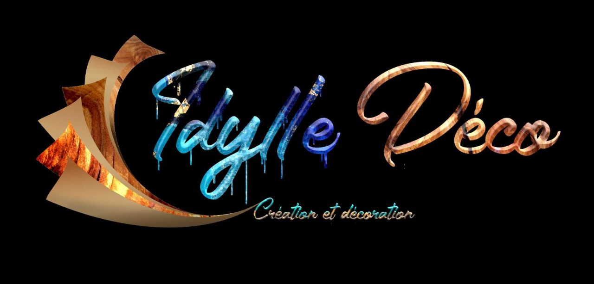

## The brief

[TODO: brief] Who Idylle Déco is, what they needed the logo for, and where it would be used.

## Process

[TODO: process] The directions explored, the sketches, and why this one was chosen.

## Final logo

## Outcome

[TODO: outcome] Where the logo is used today, and a short quote from the client.
