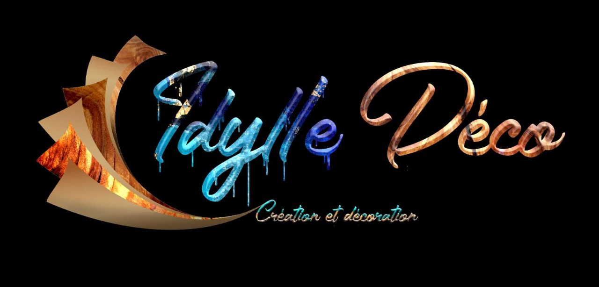

## La demande

[TODO: demande] Qui est Idylle Déco, à quoi devait servir le logo, et où il serait utilisé.

## Démarche

[TODO: démarche] Les pistes explorées, les croquis, et pourquoi celle-ci a été retenue.

## Logo final

## Résultat

[TODO: résultat] Où le logo est utilisé aujourd’hui, et une courte citation de la cliente ou du client.
