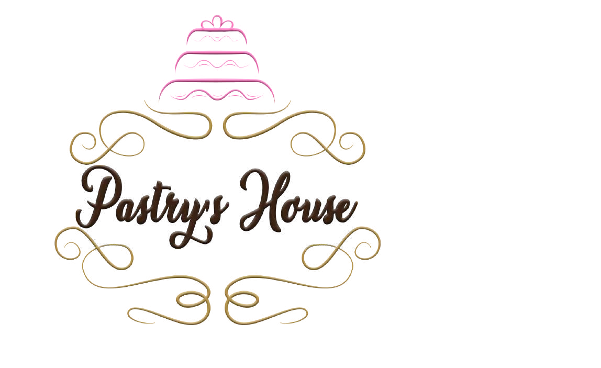
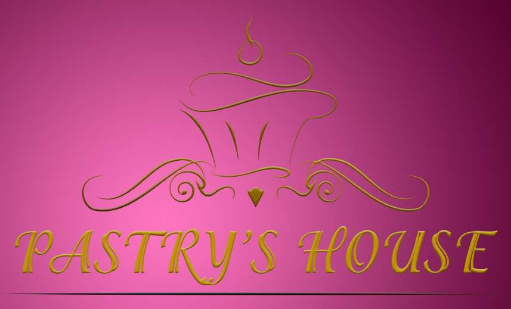

## The brief

Pastry’s House was opening without a visual identity. It needed one mark that works on cake boxes, the shop sign and Instagram, stays legible at small sizes, and feels handmade and premium at the same time.

## Process

### Sketch

Pencil studies of the cupcake and the lettering, looking for a silhouette that stays recognisable at stamp size.

### Vector

The chosen sketch redrawn in Illustrator: a line-drawn cupcake, a script wordmark and an ornamental frame.

### Final

Colour and finish: gold on a pink gradient for the signature version, flat versions for print.

## Deliverables

- Primary logo
- Wordmark and cupcake mark
- Colour and single-colour versions
- Files for print and screen

## Outcome

[TODO: outcome] Add where the logo is used today (boxes, sign, social media) and a short quote from the owner.
