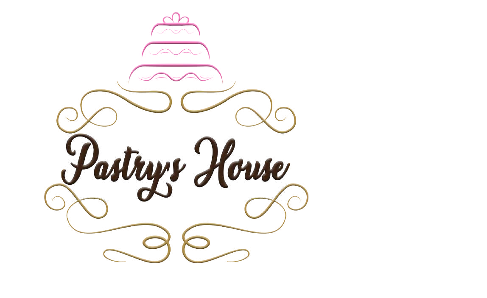
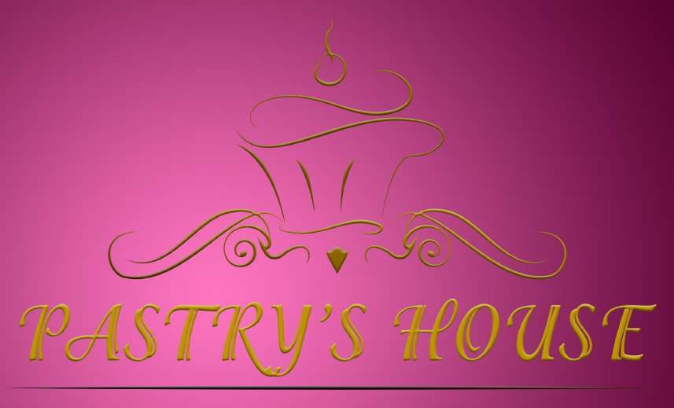

## La demande

Pastry’s House ouvrait sans identité visuelle. Il fallait une seule marque qui fonctionne sur les boîtes à gâteaux, l’enseigne et Instagram, reste lisible en petit, et paraisse à la fois artisanale et haut de gamme.

## Démarche

### Croquis

Études au crayon du cupcake et du lettrage, pour trouver une silhouette reconnaissable même en tampon.

### Vectorisation

Le croquis retenu redessiné dans Illustrator : un cupcake au trait, un logotype script et un cadre ornemental.

### Final

Couleur et finition : or sur dégradé rose pour la version signature, versions en aplat pour l’impression.

## Livrables

- Logo principal
- Logotype et symbole cupcake
- Versions couleur et monochrome
- Fichiers pour l’impression et l’écran

## Résultat

[TODO: résultat] À compléter : où le logo est utilisé aujourd’hui (boîtes, enseigne, réseaux) et une courte citation de la gérante ou du gérant.
